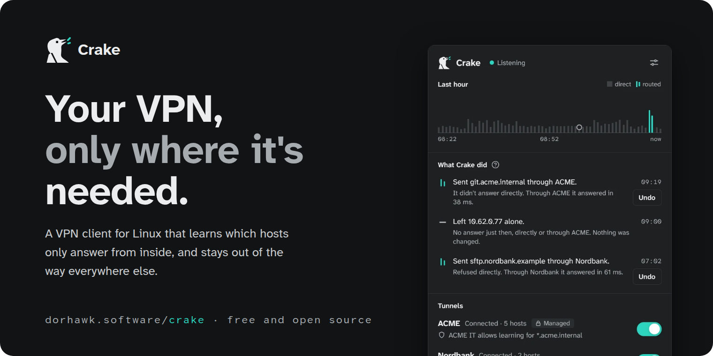
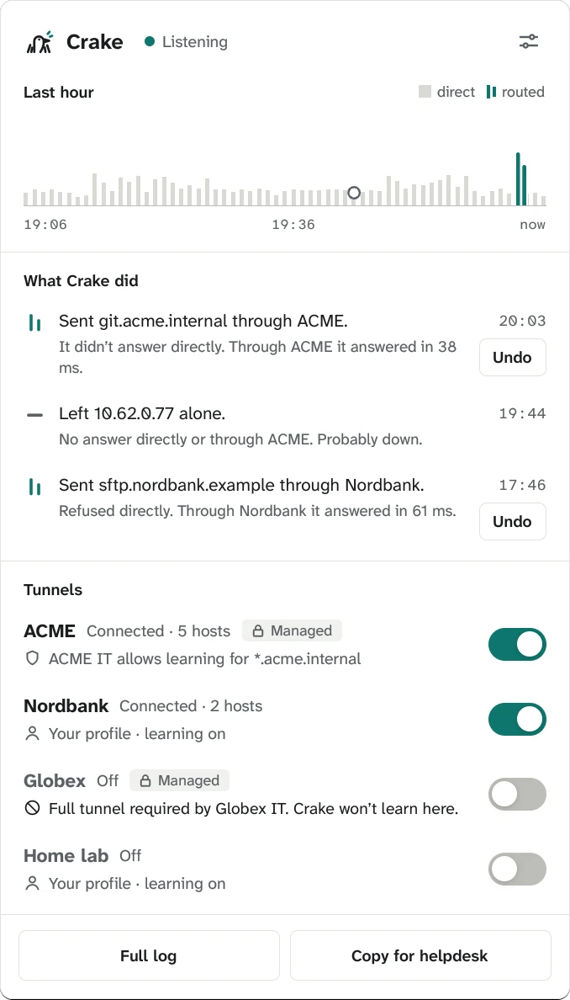
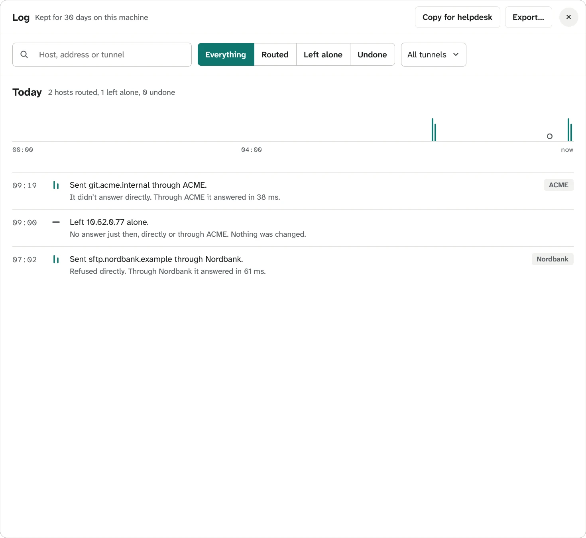
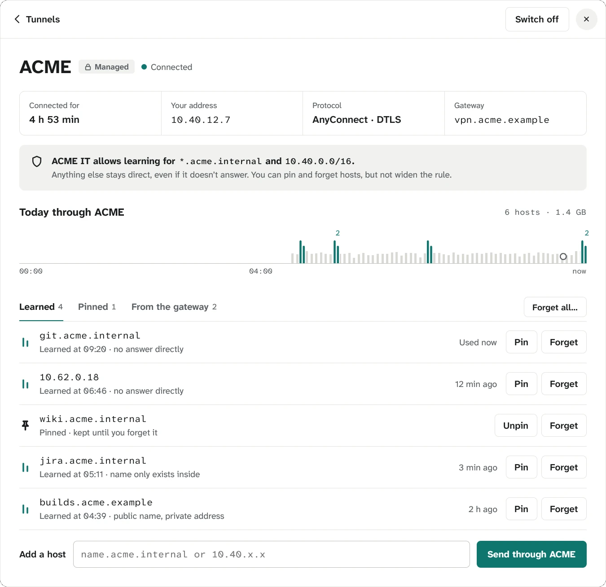
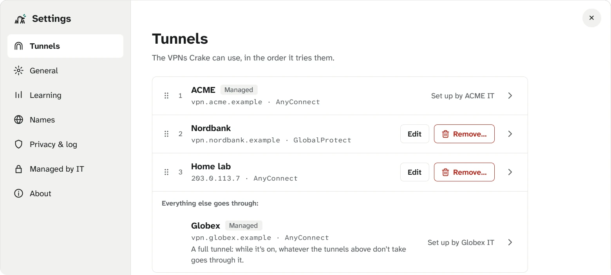
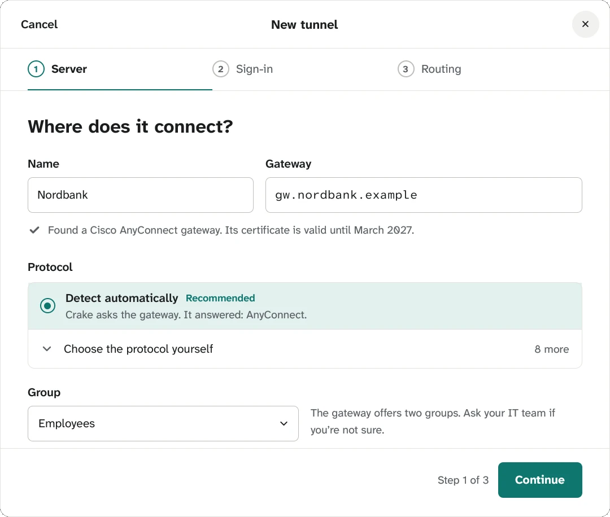
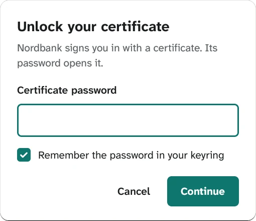
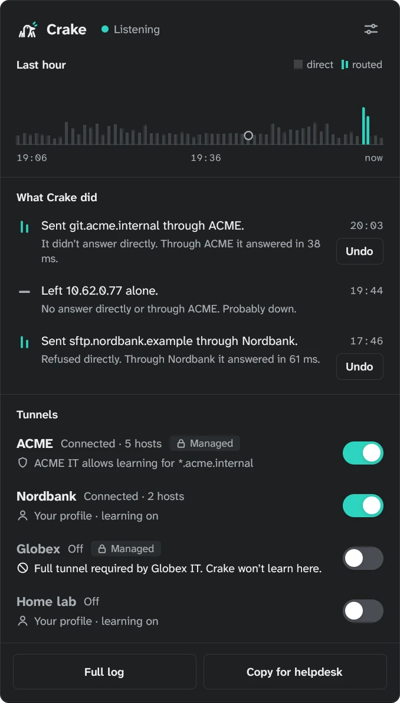

<p align="center">
  
</p>

<p align="center">
  <a href="#how-it-looks"><strong>How it looks</strong></a> &middot;
  <a href="#what-it-does"><strong>What it does</strong></a> &middot;
  <a href="#privacy"><strong>Privacy</strong></a> &middot;
  <a href="#status"><strong>Status</strong></a> &middot;
  <a href="#building-and-trying-it"><strong>Development</strong></a> &middot;
  <a href="https://dorhawk.software/crake/"><strong>Website</strong></a>
</p>

<p align="center">
  <a href="LICENSE"></a>
  <a href="#building-and-trying-it"></a>
  <a href="Cargo.toml"></a>
  <a href="#status"></a>
  <a href="#built-with-ai"></a>
</p>

<br/>

# Your VPN, only where it's needed.

A VPN client for Linux. It connects to your company VPNs, sends nothing through them until a host
only answers from inside, and then routes just that host and tells you why, in one sentence.

**Company VPNs either take all your traffic, or only the networks someone wrote into a list years
ago. Neither knows what you actually open.**

|        | Step                 | How                                                                                       |
| ------ | -------------------- | ----------------------------------------------------------------------------------------- |
| **01** | Switch a tunnel on   | Sign in with your browser, a password and one-time code, or a certificate in your keyring. |
| **02** | Work as usual        | Nothing goes through the tunnel yet. A host that only answers from inside gets routed, and only that host. |
| **03** | Read why             | "Sent git.acme.internal through ACME. It didn't answer directly. Through ACME it answered in 38 ms." Undo is one click. |

<br/>

<div align="center">
<table>
  <tr>
    <td align="center"><strong>Speaks</strong></td>
    <td align="center"><sub>Cisco AnyConnect<br/>ocserv</sub></td>
    <td align="center"><sub>Palo Alto<br/>GlobalProtect<br/><em>beta</em></sub></td>
    <td align="center"><sub>Ivanti Connect Secure<br/>(Pulse)<br/><em>beta</em></sub></td>
    <td align="center"><sub>Juniper<br/>Network Connect<br/><em>beta</em></sub></td>
    <td align="center"><sub>Fortinet<br/>SSL VPN<br/><em>beta</em></sub></td>
    <td align="center"><sub>F5<br/>BIG-IP<br/><em>beta</em></sub></td>
    <td align="center"><sub>Array<br/>Networks<br/><em>beta</em></sub></td>
    <td align="center"><sub>OpenVPN 3<br/>profiles</sub></td>
  </tr>
</table>

<em>Every protocol openconnect speaks, plus the OpenVPN 3 profiles already on your computer.
Beta: openconnect speaks it, but Crake hasn't been used against a real gateway of that kind yet.</em>

</div>

<br/>

## Crake is for you if

- ✅ you're connected to **more than one company VPN**, for an employer, a client, a home lab
- ✅ you don't want **everything you do** going through someone else's network
- ✅ your company's split-tunnel list is **out of date**, and you find out when something doesn't open
- ✅ you'd like to know **why** a host goes through a tunnel, and **undo** it when it shouldn't
- ✅ your IT wants **rules it can rely on**, and you want to see them in plain words
- ✅ you use **Linux** on your work machine

<br/>

## How it looks

<div align="center">

| The panel | The log | Tunnel detail |
|:---:|:---:|:---:|
|  |  |  |
| Drops from the tray. The last hour, what Crake did with Undo, your tunnels with their rules. | Every decision as a sentence, with its reason, on a day chart that zooms. | Who decides, today's traffic through it, its hosts: learned, pinned, from the gateway. |

| Tunnels | New tunnel | Sign-in |
|:---:|:---:|:---:|
|  |  |  |
| In the order traffic tries them, drag to change it. A full tunnel waits underneath. | Type the gateway: Crake asks it what it speaks and which groups it offers. | Your certificate's password from the keyring next time; browser sign-in for SSO. |

<br/>

**Light and dark, following your desktop.**

 

<sub>Every name, host and address in the screenshots is made up (<code>crates/crake/src/model.rs</code>,
<code>demo()</code>). Run <code>CRAKE_DEMO=1 ./target/debug/crake</code> to see them yourself.</sub>

</div>

<br/>

## What it does

<table>
<tr>
<td align="center" width="33%">
<h3>📇 Learns from DNS</h3>
A name only the company's DNS knows is routed <strong>before the first packet</strong>. Names public DNS has never heard of are asked of your tunnels too.
</td>
<td align="center" width="33%">
<h3>🔁 Learns from silence</h3>
A host that doesn't answer directly is tried through each tunnel. The one that answers gets it, and you get a sentence saying so.
</td>
<td align="center" width="33%">
<h3>↩️ Undo, always</h3>
Every decision can be undone where it's shown. Sent direct, it stays direct until you say otherwise.
</td>
</tr>
<tr>
<td align="center">
<h3>🧭 Several tunnels at once</h3>
In the order you set. When two answer for the same host, Crake asks you, takes the faster, or keeps to the order.
</td>
<td align="center">
<h3>🏢 Rules from IT</h3>
A managed profile says what a tunnel may learn, or asks for a full tunnel. Crake shows it in plain words and nobody can widen it.
</td>
<td align="center">
<h3>🔒 Public name, private address</h3>
When a company serves its own staff a different address for a public name, Crake asks the company's DNS and routes the private one.
</td>
</tr>
<tr>
<td align="center">
<h3>📶 Networks that block UDP</h3>
Crake notices, falls back to TCP on the same session, and remembers the network for next time.
</td>
<td align="center">
<h3>🔑 Keyring, not files</h3>
Passwords and certificates live in your GNOME keyring. Import a certificate once, then delete the file.
</td>
<td align="center">
<h3>🧾 Copy for helpdesk</h3>
What happened today in plain text, with host names left out if you like, ready to paste into a ticket.
</td>
</tr>
</table>

<br/>

## What Crake solves

| Problem | What Crake does about it |
| --- | --- |
| ❌ A full tunnel sends your video calls, updates and personal browsing through the company, slowly. | ✅ Nothing goes through a tunnel until a host needs it. Everything else takes the usual way. |
| ❌ The split-tunnel list is years old. A new internal service doesn't open, and nobody knows why. | ✅ Crake learns the host the first time it only answers from inside, and logs the reason. |
| ❌ Two company VPNs up at once fight over routes and DNS. | ✅ Each host goes through the one tunnel that answers for it, in an order you choose. |
| ❌ With a VPN off, your laptop asks the public internet about the company's internal names. | ✅ "Keep internal names private": with its tunnel off, a company name fails at once, quietly. |
| ❌ Something broke, and the helpdesk asks what your VPN did. | ✅ Every decision is a sentence with a reason and a time, and one button copies the day as text. |

<br/>

## Privacy

Crake sits between you and your network. It's built accordingly.

|                                  |                                                                                                   |
| -------------------------------- | ------------------------------------------------------------------------------------------------- |
| **Nothing leaves your machine.** | No account, no server, no telemetry. Ever. Every decision is made on your computer.               |
| **The log stays here.**          | Kept in your home folder for 30 days by default, or only in memory. Clearing it takes one click.  |
| **Secrets in your keyring.**     | Passwords and certificates go to the GNOME keyring, never to Crake's own files.                    |
| **Internal names stay internal.**| With a tunnel off, its company's names aren't asked of public DNS.                                 |
| **Helpdesk copies can be anonymous.** | One switch leaves host names out of what you paste into a ticket.                            |

<br/>

## Nothing to clean up

Switch it off, and your computer is as it was. Crake keeps to its own corner of the system and takes
it with it when it goes.

| What Crake uses | What it never touches |
| --- | --- |
| Its own firewall table, `inet crake`, marking only the hosts it learned | Your default route |
| Its own routing tables, one per tunnel | `/etc/resolv.conf` |
| Each tunnel's DNS, per link in systemd-resolved, gone with the tunnel | NetworkManager's connections and your firewall rules |
| The tunnel device openconnect or OpenVPN 3 creates, there only while it's on | Kernel modules and drivers |

**Stop Crake, and all of it goes.** A tunnel switched off takes its routes and DNS with it; stopping
Crake removes its table, rules and links. The namespace tests check that nothing of Crake's is left.

<br/>

## What Crake isn't

|                                       |                                                                                            |
| ------------------------------------- | ------------------------------------------------------------------------------------------ |
| **Not a VPN service.**                | It doesn't sell you a tunnel or an exit country. It connects to the VPNs you already have. |
| **Not a reimplementation.**           | The protocols are openconnect's and OpenVPN 3's. Crake's part is the routing.              |
| **Not a way around your company.**    | It doesn't fake a compliance check or hide what it does. A managed rule is kept, and shown. |
| **Not an official client.**           | It isn't made by Cisco, Palo Alto, Ivanti, Fortinet, F5, Array or OpenVPN Inc.             |

<br/>

## Technology

| | |
|---|---|
| **Daemon** | `craked`: Rust, tokio; runs openconnect per tunnel, attaches OpenVPN 3 sessions |
| **Routing** | nftables sets with per-element timeouts, fwmark policy routing, a table per tunnel |
| **DNS** | systemd-resolved per link, answers held in NFQUEUE until their route is in |
| **Probing** | conntrack events, `SO_BINDTODEVICE` probes through each tunnel |
| **App** | `crake`: Rust, GPUI, StatusNotifierItem tray, Secret Service keyring |
| **Between them** | D-Bus on the system bus, polkit for what changes routing |

<br/>

## Building and trying it

Nothing needs installing: it runs from `target/`.

```bash
cargo build
CRAKE_DEMO=1 ./target/debug/crake            # the app with made-up data, no daemon needed

sudo ./target/debug/craked --config <yours>.toml --dev
./target/debug/crake                          # the app, talking to that daemon
```

Tests and checks:

```bash
cargo test                                    # unit, lifecycle, D-Bus and headless window tests
scripts/netns-test.sh                         # real nftables and routing, in a throwaway container
scripts/e2e-test.sh                           # sign in and connect to a real ocserv, in containers with no network
scripts/lint.sh                               # rustfmt, clippy, cargo-deny, cargo-machete, private names, sizes
scripts/check-coverage.sh                     # each crate's tested share of lines stays above its floor
scripts/build-deb.sh                          # the .deb, built in an Ubuntu 22.04 container
scripts/build-rpm.sh                          # the RPM for Fedora, from the same files
scripts/build-arch.sh                         # the Arch package, from source in an Arch container
scripts/deb-test.sh [release...]              # install and use it in containers: 22.04 … debian:12 … fedora:44
scripts/vm-test.sh [release]                  # the same in a throwaway VM: AppArmor (Ubuntu) or SELinux (fedora:44) enforcing
```

- **Needs:** openconnect, nftables, iproute2, systemd-resolved, and a tray: GNOME with the
  AppIndicator extension, or KDE. OpenVPN 3 for its profiles.
- **Config:** `packaging/craked.toml.example`.
- **The design:** `design/DESIGN.md` and the approved screens in `design/screens/`, open in a browser.

<br/>

## Quality

**Every warning is an error.** Clippy with all lints denied, `cargo-deny` (known vulnerabilities,
licences, sources), `cargo-machete` (unused dependencies) and a check that nothing customer-specific
is ever committed all have to pass; a failure stops the build.

Routing is tested where it can't lie: the namespace tests run real nftables and policy routing in a
disposable container, with a fake gateway that drops packets not from the tunnel, the way a real one
does. Several tests guard decisions rather than behaviour: that an answer is never released before
its route is in, that a full tunnel never takes the local network, that a stuck connection is
forgotten so the app's next try goes through.

<br/>

## Status

**In daily use, before its first release.**

- ✅ Per-host learning from DNS and from probing, with undo
- ✅ Several tunnels side by side, try order, when two answer
- ✅ Managed profiles and full tunnels, policy shown in plain words
- ✅ Public name, private address (split-horizon DNS)
- ✅ Internal names kept private while a tunnel is off
- ✅ Gateways that only admit Cisco's client, said openly
- ✅ OpenVPN 3 profiles, including sessions started elsewhere
- ✅ Tray, panel, log, settings, new tunnel, sign-in, tunnel detail; light and dark
- 🟡 Networks that block UDP: built and tested against a real AnyConnect server, not yet tried on
  such a network
- 🟡 GlobalProtect, Ivanti/Pulse, Juniper, Fortinet, F5 and Array: spoken through openconnect,
  marked Beta in the app until each has been used against a real gateway
- ✅ Tunnels that can't be up together: refused with the reason, before they half-work
- ✅ A tunnel's DNS that stops answering: said so, known names keep working
- ✅ One `.deb` for Ubuntu 26.04, 24.04 and 22.04 (password or certificate sign-in there: its
  openconnect is too old for the browser) and Debian 13 and 12, each installed and tested;
  a systemd service, polkit, an AppArmor profile; upgrades keep tunnels signed in
- ✅ An RPM for Fedora 45, 44 and 43, the same binaries, tested the same way (and in a VM with
  SELinux enforcing)
- ✅ An Arch package (PKGBUILD for the AUR), tested the same way
- ⚪ NixOS
- ⚪ IPv6

<br/>

## Built with AI

Crake was written largely by an AI, [Claude](https://claude.ai) by Anthropic. It's said here plainly:
without that help it wouldn't exist yet, and there's no reason to hide it.

What that means in practice:

- **A person decides what gets built and what ships.** The plan, the decisions and what isn't done
  yet are written down in [`CLAUDE.md`](CLAUDE.md) and [`design/DESIGN.md`](design/DESIGN.md).
- **Nothing ships because it looks finished.** Tests, the lint gate, real routing in a namespace, and
  use against real company gateways every day.
- **Decisions are written down, not just made.** Comments explain why, especially where something
  looks like needless complication: why a DNS answer is held until its route is in, why Crake never
  scans a network, why a tick in a chart keeps clear of the bars.

A bug in Crake is on the people who released it. AI helping doesn't excuse it, and isn't used as an
excuse here.

<br/>

## Support

Crake is and will stay free and open source. If it saved you a helpdesk ticket and you'd like to say
thanks, you can [buy the developers a coffee](https://buymeacoffee.com/software.dorhawk). Nothing gets
unlocked; it's a thank-you, not a subscription.

<br/>

## Licence

[GPL-3.0-or-later](LICENSE). Crake is an independent client. It isn't made by, or affiliated with,
any VPN vendor, and it connects only to gateways you're allowed to use.

<br/>

---

<p align="center">
  <sub>Named after the corncrake, <em>Crex crex</em>: a meadow bird heard far more often than seen.
  Part of <a href="https://dorhawk.software">dorhawk.software</a>.</sub>
</p>
